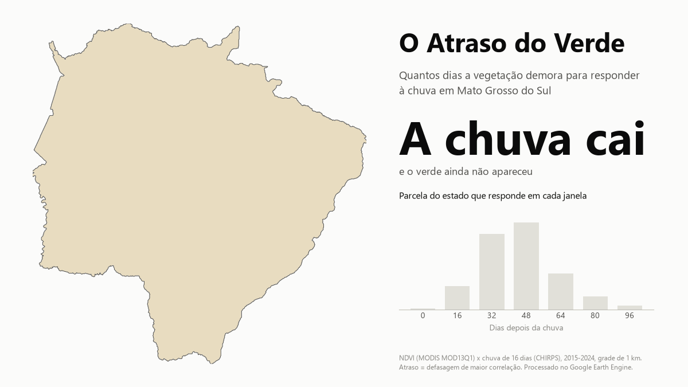
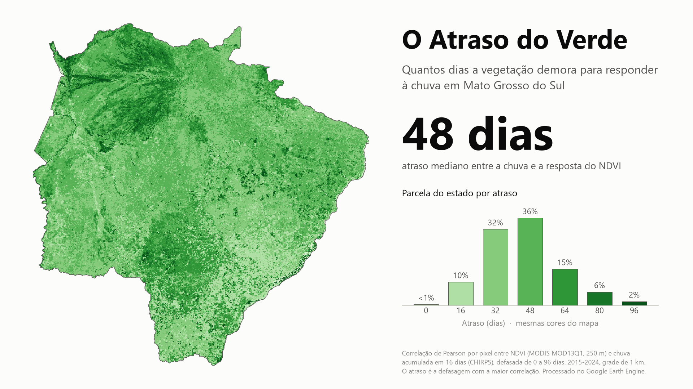

# O Atraso do Verde

**Quantos dias a vegetação demora para responder à chuva em Mato Grosso do Sul?**



A chuva cai hoje, mas o pasto, a lavoura e o Cerrado não ficam verdes hoje. Este
projeto mede esse intervalo, pixel a pixel, para o estado inteiro, usando dez anos
de imagens de satélite processadas no Google Earth Engine.

## Resultado

Para 2015-2024, em Mato Grosso do Sul:



No mapa, verde claro é resposta rápida e verde escuro é resposta lenta. Na
animação do topo, cada pixel acende no dia do seu atraso.

- **Atraso mediano: 48 dias.** Média: 44,6 dias.
- Em 68% do estado, o atraso fica entre 32 e 48 dias.
- A correlação máxima mediana entre chuva e NDVI é 0,53.

Distribuição do atraso no estado:

| Atraso (dias) | Parcela do estado |
|---|---|
| 0 | 0,4% |
| 16 | 9,7% |
| 32 | 31,5% |
| 48 | 36,2% |
| 64 | 15,0% |
| 80 | 5,6% |
| 96 | 1,6% |

Esses números vêm do raster exportado em grade de 1 km (384.959 pixels válidos) e
estão em [resultados/resumo_1km.json](resultados/resumo_1km.json). Uma conferência
independente, calculada direto no Earth Engine em grade de 5 km, deu a mesma
mediana (48 dias) e média de 45,2 dias; está em
[resultados/estatisticas.json](resultados/estatisticas.json).

## Como funciona

1. **NDVI**: série MODIS MOD13Q1 v061 (composições de 16 dias, 250 m), mantendo
   apenas pixels com qualidade boa ou marginal (`SummaryQA <= 1`). São 230 imagens.
2. **Chuva**: CHIRPS Daily, somada em janelas de 16 dias.
3. **Defasagem**: para cada imagem de NDVI, a janela de chuva é deslocada para
   trás em 0, 16, 32, 48, 64, 80 e 96 dias.
4. **Correlação**: para cada defasagem, calcula-se a correlação de Pearson por
   pixel entre NDVI e chuva ao longo dos dez anos.
5. **Atraso**: em cada pixel, fica a defasagem que deu a maior correlação.

## O que este resultado não diz

- O atraso só pode assumir múltiplos de 16 dias, porque essa é a resolução
  temporal do NDVI usado. "48 dias" significa "a janela de 48 a 64 dias antes".
- Correlação não é causa. Em uma região de chuva e vegetação fortemente sazonais,
  parte da correlação vem do ciclo anual compartilhado, e não só da resposta
  direta da planta à água.
- Não há validação de campo. O resultado é uma leitura de satélite.
- Áreas irrigadas, alagadas (Pantanal) ou de floresta perene podem ter correlação
  máxima baixa; nesses pixels o atraso é pouco informativo. A banda `corr` do
  raster exportado permite filtrar isso.

## Como rodar

### No Code Editor do Earth Engine

Cole [gee/atraso_do_verde_ms.js](gee/atraso_do_verde_ms.js) em
<https://code.earthengine.google.com>, clique em **Run** e inicie a exportação na
aba **Tasks**. O GeoTIFF sai na pasta `GEE` do Google Drive com duas bandas:
`lag_dias` e `corr`.

### Em Python

```bash
pip install earthengine-api
earthengine authenticate
export EE_PROJECT=seu-projeto-cloud      # Windows: set EE_PROJECT=seu-projeto-cloud
python python/atraso_do_verde_ms.py
```

### Para refazer a figura e a animação

```bash
pip install rasterio matplotlib numpy pillow
python python/figura.py caminho/atraso_do_verde_MS_2015_2024.tif
python python/animacao.py caminho/atraso_do_verde_MS_2015_2024.tif
```

## Estrutura

```
gee/atraso_do_verde_ms.js       script para o Code Editor
python/atraso_do_verde_ms.py    mesma análise pela API Python
python/figura.py                gera o mapa a partir do GeoTIFF
python/animacao.py              gera o GIF animado
resultados/resumo_1km.json      números do raster de 1 km (os da figura)
resultados/estatisticas.json    conferência no Earth Engine em grade de 5 km
figuras/                        figura e animação do README
```

## Dados

- **CHIRPS Daily**: Funk, C. et al. (2015). The climate hazards infrared
  precipitation with stations - a new environmental record for monitoring
  extremes. *Scientific Data*, 2, 150066.
- **MODIS MOD13Q1 v061**: Didan, K. (2021). MODIS/Terra Vegetation Indices 16-Day
  L3 Global 250m SIN Grid V061. NASA EOSDIS Land Processes DAAC.
- **Limite estadual**: FAO GAUL 2015, nível 1.
- Processamento: Google Earth Engine.
